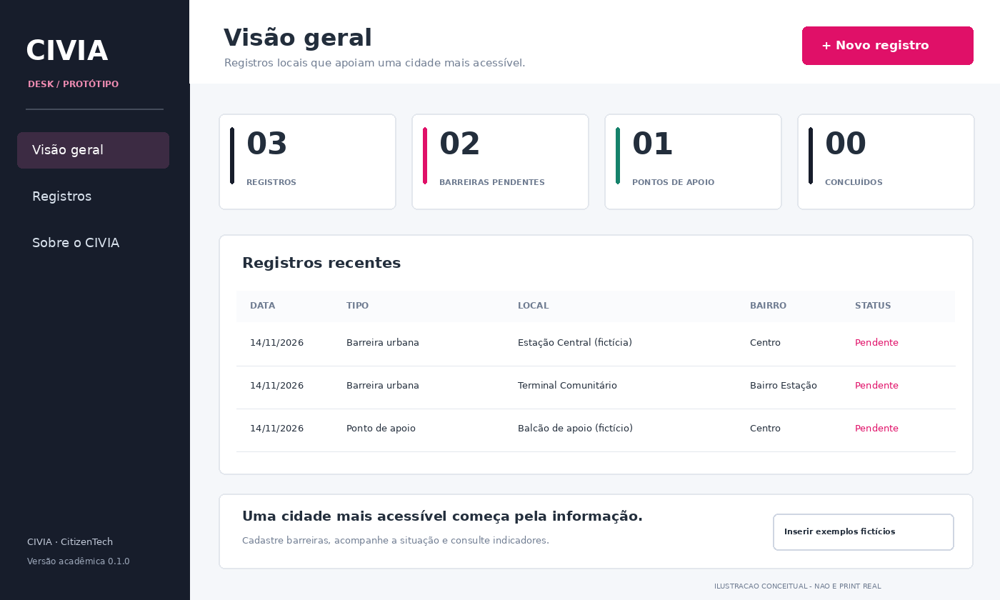

# CIVIA Desk — Central Comunitária de Acessibilidade

**Global Solution 2026.2 | C# Software Development | Engenharia de Software**

Aplicação desktop simples em **C# e Windows Forms (.NET 8)** para cadastrar e acompanhar **barreiras urbanas** e **pontos de apoio à acessibilidade**. O projeto integra o conceito CIVIA, mas é um protótipo independente do aplicativo dos óculos inteligentes.

> **Status:** protótipo acadêmico local. Sem câmera, IA, integração com óculos, geolocalização em tempo real ou envio real de emergências.

## Ficha da CitizenTech

| Campo | Resposta |
|---|---|
| **Nome da CitizenTech** | CIVIA — A cidade se adapta a você |
| **Cidade e bairro** | Cenário piloto: Santo André (SP), região central. Os registros de demonstração são fictícios. |
| **Cidadão beneficiado** | Pessoas cegas, com baixa visão, surdas ou com perda auditiva que precisam de informações sobre a acessibilidade de locais urbanos. O painel pode ser usado por operadores em postos comunitários. |
| **Problema, em uma frase** | Barreiras de informação e acesso dificultam deslocamentos e a participação de pessoas com deficiência na cidade. |
| **Como funciona** | O operador registra a barreira ou o ponto de apoio, informa localização e público beneficiado, acompanha o status e consulta os dados em um painel local. |
| **O que cada parte faz** | `Models/`: representa os registros; `Services/`: valida fluxo e salva JSON; `Views/`: telas de cadastro e consulta. |
| **Link do repositório** | **PREENCHER APÓS PUBLICAR NO GITHUB** |
| **Indicador de impacto** | Número de barreiras registradas, barreiras concluídas e pontos de apoio identificados. O protótipo demonstra o cálculo, não comprova impacto real. |
| **ODS conectados** | **ODS 10**: ampliar inclusão e reduzir desigualdades (meta 10.2). **ODS 11**: apoiar cidades e transporte mais acessíveis (meta 11.2). |

## O problema e quem pode ser beneficiado

O CIVIA parte de dificuldades cotidianas, como sinalizações difíceis de ler e avisos sonoros sem alternativa visual. O **CIVIA Desk** traduz parte dessa proposta para um atendimento comunitário: um terminal que concentra relatos e permite acompanhar o tratamento de cada registro.

**Perfil de pessoa beneficiada:** cidadão com deficiência visual ou auditiva que utiliza serviços e transporte público em Santo André/SP. Trata-se de um público real, porém **a equipe ainda deverá validar as necessidades com pessoas desse público**. Os exemplos incluídos no sistema são **100% fictícios** e não devem ser apresentados como ocorrências reais.

## Prévia conceitual da interface



*Ilustração de referência visual; não é captura do aplicativo executado.*

## Funcionalidades

- Painel inicial com indicadores e registros recentes.
- Cadastro de **barreiras urbanas** e **pontos de apoio**.
- Escolha do público beneficiado (visual, auditivo ou ambos).
- Validação dos campos antes de salvar.
- Lista com busca por local, bairro ou descrição e filtro por tipo.
- Consulta dos detalhes com duplo clique.
- Alteração de status: **Pendente**, **Em análise**, **Resolvido/Verificado**.
- Exclusão com confirmação.
- **Salvamento automático local em JSON**, mantendo os dados entre execuções.
- Exportação de relatório em **CSV**.
- Botão opcional para inserir três registros **fictícios** de demonstração.

## Tecnologias utilizadas

- C# 12, .NET 8, Windows Forms
- `System.Text.Json` para persistência em JSON
- Git e GitHub para versionamento
- Sem banco de dados, pacotes externos ou dependências de internet

## Estrutura do projeto

```text
CIVIA_Desk_Projeto/
├── CIVIA.Desk.sln
├── CIVIA.Desk/
│   ├── CIVIA.Desk.csproj
│   ├── Program.cs
│   ├── Models/
│   │   ├── Tipos.cs
│   │   └── RegistroAcessibilidade.cs
│   ├── Services/
│   │   ├── RepositorioJson.cs
│   │   └── RegistroService.cs
│   └── Views/
│       ├── CiviaUI.cs
│       ├── FrmPrincipal.cs
│       └── FrmCadastro.cs
├── .github/workflows/build.yml
├── README.md
├── CHANGELOG.md
├── GUIA_GIT_PR.md
├── prompts.md
├── integrantes.txt
└── entrega-teams.txt
```

A interface é construída em código nos arquivos `Views/`, para ficar fácil de compreender sem depender de arquivos de Designer gerados automaticamente.

## Como executar no Visual Studio

**Requisitos:** Windows 10/11; Visual Studio 2022 com a carga de trabalho **Desenvolvimento para desktop com .NET**; SDK do **.NET 8**.

1. Extraia o ZIP em uma pasta do Windows.
2. Abra **`CIVIA.Desk.sln`** no Visual Studio.
3. Aguarde a restauração do projeto (não há pacotes extras).
4. Selecione **CIVIA.Desk** como projeto de inicialização, se necessário.
5. Pressione **F5** para executar.
6. Vá a **Visão geral** e clique em **Inserir exemplos fictícios** para uma demonstração, ou use **+ Novo registro** para cadastrar.

Alternativamente, na pasta do projeto, use:

```powershell
dotnet run --project .\CIVIA.Desk\CIVIA.Desk.csproj
```

O aplicativo **só executa no Windows** por utilizar Windows Forms. Não há integração com dados de produção.

## Como usar

1. Clique em **+ Novo registro**.
2. Escolha entre **Barreira urbana** ou **Ponto de apoio**.
3. Informe local, bairro, público beneficiado, prioridade e descrição.
4. Salve. O sistema valida os campos e registra os dados localmente.
5. Em **Registros**, pesquise, filtre, abra detalhes ou altere o status.
6. Use **Exportar CSV** para gerar uma planilha de acompanhamento.

### Persistência e privacidade

Os dados ficam no arquivo do usuário Windows:

```text
%LOCALAPPDATA%\CIVIA\Desk\registros.json
```

O arquivo é salvo após cada operação, primeiro em arquivo temporário e depois substituído. Nenhuma informação é enviada para servidores. **Não insira dados pessoais ou de saúde de cidadãos** nesta demonstração.

Para redefinir os registros em um ambiente de testes, feche o aplicativo e **faça backup** do `registros.json` antes de apagá-lo. Arquivos com JSON inválido não são apagados automaticamente.

## Programação Orientada a Objetos (POO)

- **Classe `RegistroAcessibilidade`**: propriedades encapsuladas, construtor com validação e método `AlterarStatus()`.
- **Enums `TipoRegistro`, `PublicoAtendido`, `Prioridade` e `StatusRegistro`**: evitam estados inválidos por textos arbitrários.
- **Classe `RegistroService`**: coordena cadastro, consulta, alteração de status, exclusão e exportação.
- **Classe `RepositorioJson`**: responsável por leitura e gravação em arquivo.
- **Formulários `FrmPrincipal` e `FrmCadastro`**: separação entre interface e regras da aplicação.

## Versionamento semântico e Pull Request

Versão inicial proposta: **`v0.1.0`**. O fluxo de commits, branch e PR está em **[GUIA_GIT_PR.md](GUIA_GIT_PR.md)**. O PR precisa ser criado **depois que a equipe publicar o projeto em um repositório próprio**; ele não é criado automaticamente pelo ZIP.

## Evidências recomendadas para o Teams

1. Print da visão geral com indicadores.
2. Print do cadastro validando campos.
3. Print da lista com um registro resolvido.
4. Print do arquivo JSON ou CSV gerado.
5. Link do repositório e do PR aberto ou concluído.

## Limitações e próximos passos

Este protótipo não substitui a plataforma CIVIA, não monitora riscos reais e não verifica a veracidade dos registros. Uma versão futura poderia autenticar operadores, validar relatos com instituições e integrar dados oficiais de acessibilidade. O MVP principal pode continuar independente em outra tecnologia.

## Integrantes

| Integrante | RM |
|---|---|
| Ana Luiza Santana da Rocha | 561194 |
| Evandro Yuji Kaibara de Oliveira | 559274 |
| Guilherme Rodrigues Leite | 560131 |
| Luís Filipe Crivellaro | 560877 |
| Pedro Henrique Batista Bergamin | 559443 |

---

**CIVIA — A cidade se adapta a você.**
